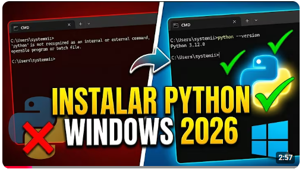

# Requisitos previos

Primero devemos checar si python esta instalado y configurar sus variables de entorno.

## Checar instalacio de python y su versión.

1 .- Habre una terminal en power shell de preferencia como Administrador.


2.- Ejecutar el interprete de python y si esta bien instaldo debe aparecer al parecido a la siguiente imagen:


Si note parace asi es que o no tienes instalado python o notienes configurado el PATH en las variables de entorno en tu sistema 

## Instala la Python.

Instala una versión de Python 3 (para la cual está escrito este tutorial). Las opciones incluyen:

(Todos los sistemas operativos) Descarga desde python.orgNormalmente, utilice el botón de descarga que aparece primero en la página.
(Linux) La instalación integrada de Python 3 funciona bien, pero para instalar otros paquetes de Python debe ejecutar sudo apt install python3-pipen la terminal.
(macOS) Instalación mediante Homebrewen macOS usando brew install python3.
(Todos los sistemas operativos) Una descarga desde Anaconda(con fines de ciencia de datos).
En Windows, asegúrese de que la ubicación de su intérprete de Python esté incluida en la variable de entorno PATH. Puede comprobar la ubicación ejecutando pathel comando en la línea de comandos. Si la carpeta del intérprete de Python no está incluida, abra la Configuración de Windows, busque "entorno", seleccione " Editar variables de entorno para su cuenta " y, a continuación, edite la variable PATH para incluir dicha carpeta.

[](https://youtu.be/E9Eu3fGvwa0?si=9BpMDYK893_mXVsx)

Despues vuelve a checar si ya se pude ejecutar python en cualquier directorio del sistema

# Crea un entorno de proyecto para el tutorial de Flask.

En esta sección, crearás un entorno virtual donde se instalará Flask. El uso de un entorno virtual evita la instalación de Flask en un entorno Python global y te brinda un control preciso sobre las bibliotecas utilizadas en una aplicación.

La extensión Python Environments admite varios tipos de entornos, incluidos venv, conda, poetry y otros. Este tutorial utiliza venv porque está integrado en Python y no requiere herramientas adicionales. Los pasos para otros tipos de entornos son similares; consulte la sección «Crear entornos» para obtener más detalles.

En su sistema de archivos, cree una carpeta para este curso, como por ejemplo aura_tracker:


Abra esta carpeta en VS Code navegando a la carpeta en una terminal y ejecutando code ., o ejecutando VS Code y usando el comando Archivo > Abrir carpeta:


Crea un entorno virtual utilizando el comando Python: Create Environment :

Abre la paleta de comandos ( Ctrl+Mayús+P )


Busque y seleccione Python: Crear entorno
Seleccione Venv para crear un entorno venv.


Seleccione un intérprete de Python para usar en el entorno.


VS Code crea una .venvcarpeta en tu espacio de trabajo y selecciona automáticamente el nuevo entorno.


Abre una terminal y veras que el venv ya esta activado.

como desactivar un entorno virtual vnev con el comando deactivate

Desactivar venv:
   ```sh
   deactivate
   ```
para volverlo a activar:
   ```sh
   .venv\Scripts\activate.bat
   ```

# Instala Flask en el entorno virtual utilizando uno de estos métodos:

##Uso de la interfaz de usuario de administración de paquetes:

Usando la terminal:

Ejecutar terminal: Crear nueva terminal ( Ctrl+Mayús+` ) desde la paleta de comandos, lo que crea una terminal y activa automáticamente el entorno virtual. Luego ejecute:

   ```sh
   python -m pip install flask
   ```

