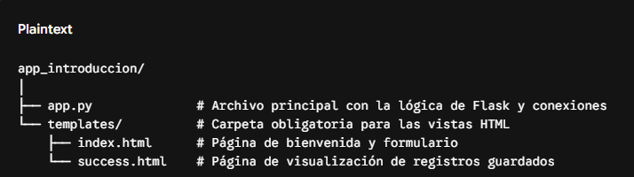

## Antes de empezar con la demostración de la ___app web___, vamos a diseñar una práctica introductoria paso a paso. 

Esta aplicación constará de dos páginas:

- Página de Bienvenida / Inicio (index.html): Presenta la estructura básica con Bootstrap y un formulario de registro.

- Página de Confirmación / Listado (success.html): Muestra los datos que el usuario acaba de registrar y permite ver los registros acumulados tanto en MySQL (base de datos relacional) como en MongoDB (base de datos NoSQL).

## Requisitos Previos y Entorno de Trabajo
Antes de escribir código, asegúrate de tener instalado en las computadoras del laboratorio (o en las máquinas de los alumnos):

- Python (versión 3.8 o superior).
- MySQL Server (o XAMPP/WampServer que lo incluya).
- MongoDB (puede ser local o un cluster gratuito en MongoDB Atlas).

## 1. Crear un fichero en donde guardarmos la practica y creamos un [entorno virtual](inst_&_set.md).

## 2. Instalación de Dependencias
Los alumnos deben abrir su terminal (o consola) e instalar Flask y los conectores para bases de datos ejecutando:

  ```sh
  pip install flask pymysql mysql-connector-python pymongo
```

- Flask: Microframework de Python para crear la app web.
- PyMySQL / mysql-connector-python: Librerías para conectar Python con MySQL.
- PyMongo: Librería oficial para conectar Python con MongoDB.

## 📂 Estructura del Proyecto
Crea una carpeta llamada app_introduccion y dentro de ella la siguiente estructura de archivos y carpetas:



## Parte 1: Conceptos Teóricos Clave para los Alumnos
Antes de codificar, explícales brevemente estos tres pilares:

___¿Qué es Flask?___ Es un "microframework" web de Python. Se llama micro porque es ligero y minimalista: nos da las herramientas básicas para escuchar peticiones web (GET, POST) y nosotros decidimos qué librerías agregar.

¿Por qué usar Bootstrap? Es un framework de CSS creado por Twitter. Nos ahorra diseñar botones, formularios y barras de navegación desde cero usando clases prediseñadas (ej. class="btn btn-primary").

___MySQL___ vs. ___MongoDB___ (Relacional vs. NoSQL):

___MySQL___ guarda la información en tablas con filas y columnas estrictas (esquema rígido). Ideal para datos muy estructurados.

___MongoDB___ guarda la información en documentos (formato similar a JSON, llamados BSON) dentro de colecciones. No exige un esquema fijo, lo que lo hace muy flexible.

## Parte 2: Creación del Código

Paso 1: El archivo principal (app.py)
Este archivo contiene las rutas web y la lógica para conectarnos a ambas bases de datos simultáneamente.

Nota pedagógica: Asegúrate de cambiar las credenciales (root, contraseña, localhost) según la configuración del servidor de los alumnos.

